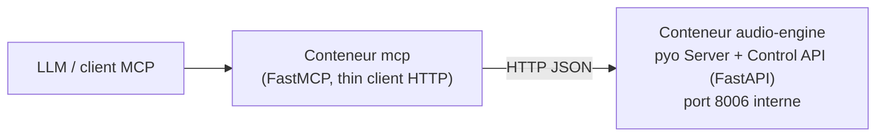

# Plan — Séparation MCP / Serveur audio

> Document de travail pour attaquer la refonte dans un autre chat.
> Date : 2026-09-26. État : non-root ✅ fait, détection audio ✅ OK (AudioBox USB 96).

## 1. Contexte & décisions déjà prises

**Problème actuel :**
- `app/main.py` boot le pyo Server et tient `inputs` (liste d'`AudioStream`) en variables globales.
- `app/monkey_mcp/mcp.py` **et** `app/monkey_api/api.py` y accèdent via le hack `sys.modules["__main__"].__dict__`.
- `api.py` et `mcp.py` sont ~90% dupliqués (mêmes fonctions, même logique).

**Décisions validées avec l'utilisateur :**
1. **Transport MCP → audio : HTTP/JSON (FastAPI)** — réutilise les deps existantes, pas d'infra extra.
2. **Fusion de l'API REST** : une seule **Control API** (FastAPI) = source de vérité de la logique. Le MCP devient un **thin client HTTP**. `api.py` et la duplication disparaissent.
3. **2 services docker-compose** : `audio-engine` (avec `/dev/snd`) + `mcp` (qui pointe dessus).
4. **Suppression du front** : `app/static/` (`index.html`, `mix_table.html`) n'est plus nécessaire.

**Contrainte technique clé :**
- Le pyo Server doit vivre dans **un seul process** (un seul thread de contrôle pour manipuler les objets audio en sécurité).
- On ne déplace pas l'audio — on sépare le **plan de contrôle** de l'audio.
- Thread-safety pyo : toutes les mutations audio doivent être **sérrialisées** (lock ou executor mono-thread), car FastAPI tourne en threadpool.

## 2. Architecture cible



- **Process 1 `audio-engine`** : boot pyo, possède `inputs`, expose la Control API (FastAPI) = la seule copie de la logique.
- **Process 2 `mcp`** : FastMCP qui ne fait que traduire les tool calls en appels HTTP vers la Control API. Zéro pyo, zéro `sys.modules`.

## 3. Structure de fichiers cible

```
app/
  audio_engine.py        # NOUVEAU : boot pyo + AudioStreams + FastAPI Control API (source de vérité)
  control_api.py         # NOUVEAU (optionnel) : routes FastAPI factorisées si audio_engine.py devient trop gros
  mcp_client.py          # NOUVEAU : FastMCP thin client HTTP (remplace monkey_mcp/mcp.py)
  libs/
    audio_stream.py      # inchangé (classe AudioStream)
    effect_lib.py        # inchangé
    utils.py             # déjà corrigé (création auto des dossiers)
  main.py                # à simplifier/supprimer : remplacé par audio_engine.py + mcp_client.py
  monkey_api/            # À SUPPRIMER (fusionné dans la Control API)
  monkey_mcp/            # À SUPPRIMER (remplacé par mcp_client.py)
  static/                # À SUPPRIMER (front retiré)
  core/                  # fichiers de test — à trier (garder dans tests/ ou supprimer)
  detect-sc.py           # garder (diagnostic)
```

## 4. Phases d'implémentation

### Phase 1 — Control API (source de vérité)
- Créer `app/audio_engine.py` :
  - Boot pyo Server (logique actuelle de `main.py` : détection devices, `pa_get_devices_infos`, `AudioStream` par canal d'entrée).
  - FastAPI app avec les routes (portées depuis `api.py`, qui est la version la plus propre) :
    - `GET /global_status`
    - `GET /list_inputs_outputs`
    - `GET /list_inputs`
    - `GET /list_effects/{index}`
    - `POST /mute_input/{index}` / `POST /unmute_input/{index}`
    - `POST /add_effect_to_input/{index}` (body: `effect_path`, `params`, `position`)
    - `POST /update_effect/{index}`
    - `POST /remove_effect_from_input/{index}` (body: `effect_index`)
    - `POST /start_input_recording/{index}` / `POST /stop_input_recording/{index}`
  - **Sérrialisation des mutations audio** : un `threading.Lock` (ou `asyncio.to_thread` + lock) autour de tout appel qui touche pyo/AudioStream.
  - Config via env : `AUDIO_API_HOST` (défaut `127.0.0.1` ou `0.0.0.0`), `AUDIO_API_PORT` (défaut `8006`).
  - Lancer avec uvicorn (déjà dans requirements).
- **Bugs à corriger en portant** (repérés dans le code actuel) :
  - `update_effect` dans `api.py`/`mcp.py` fait en fait un `add_effect` (copie-collé) — implémenter la vraie mise à jour (voir TODO dans `AudioStream.update_effect`).
  - `main.py` ligne 18 : `raise("...")` sans exception — corriger en `raise SystemExit(...)` ou `parser.error(...)`.
  - `mcp.py`/`api.py` : `from venv import logger` (import parasite, logger de la stdlib venv !) — remplacer par `logging.getLogger(__name__)`.
  - `start_input_recording` accepte `filename` en query param (FastAPI) / absent (MCP) — uniformiser.

### Phase 2 — MCP thin client
- Créer `app/mcp_client.py` :
  - `FastMCP("Monkey Resonance MCP", host=..., port=...)` (env `MCP_HOST`/`MCP_PORT`, défaut 8005).
  - Chaque tool = appel HTTP vers la Control API (`http://audio-engine:8006/...` en compose, `http://127.0.0.1:8006` en local) via `httpx` ou `requests` (à ajouter dans requirements si absent).
  - Garder le prompt `help()` et les docstrings (c'est ce que le LLM lit).
  - Gérer les erreurs HTTP → retourner `{"error": ...}` proprement.
  - **Aucun import pyo, aucun `sys.modules`**.
- Supprimer `app/monkey_mcp/` et `app/monkey_api/`.

### Phase 3 — docker-compose 2 services
```yaml
services:
  audio-engine:
    build: { dockerfile: ./Dockerfile }
    user: mkr
    volumes:
      - ~/monkey-resonance:/monkey-resonance
    devices:
      - "/dev/snd:/dev/snd"
    environment:
      - AUDIO_API_HOST=0.0.0.0
      - AUDIO_API_PORT=8006
    command: ["uvicorn", "audio_engine:app", "--host", "0.0.0.0", "--port", "8006"]

  mcp:
    build: { dockerfile: ./Dockerfile }
    user: mkr
    depends_on:
      - audio-engine
    environment:
      - AUDIO_API_URL=http://audio-engine:8006
      - MCP_HOST=0.0.0.0
      - MCP_PORT=8005
    ports:
      - "8005:8005"
    command: ["python", "mcp_client.py"]
```
- Le service `mcp` **n'a pas besoin** de `/dev/snd` (il ne touche plus l'audio).
- Renommer le service `mkr` → `audio-engine` (mettre à jour le devcontainer en conséquence, voir §6).

### Phase 4 — Nettoyage
- Supprimer : `app/static/`, `app/monkey_api/`, `app/monkey_mcp/`, `app/main.py` (si remplacé), trier `app/core/` (tests → `tests/` ou suppression).
- `requirements.txt` : ajouter `httpx` (ou `requests`) pour le client MCP ; vérifier que tout le reste est encore utilisé.
- Mettre à jour `README.md` (commandes de lancement) et `USAGE_MCP.md` (le pattern `call_method_on_global`/`sys.modules` n'existe plus — réécrire autour des tools HTTP).
- `.gitignore` : ajouter `*.wav` déjà présent, vérifier `in_container_options`.

## 5. Validation (à chaque phase)

```bash
# Phase 1 : Control API seule
docker compose run --rm --entrypoint sh audio-engine -c '
  uvicorn audio_engine:app --host 0.0.0.0 --port 8006 &
  sleep 3
  curl -s http://127.0.0.1:8006/global_status
  curl -s http://127.0.0.1:8006/list_inputs
'

# Phase 2 : MCP client
# - tester avec un client MCP (ex: mcp client CLI) : lister les tools, appeler list_inputs, mute_input
# - vérifier qu'aucun import pyo dans mcp_client.py

# Phase 3 : les 2 services
docker compose up -d
curl -s http://localhost:8006/global_status   # via audio-engine si port exposé pour test
# appeler un tool MCP via le port 8005

# Non-root : vérifier ls -la ~/monkey-resonance/records après un enregistrement → owned par ubuntu
```

## 6. Points d'attention / pièges connus

- **Non-root déjà en place** (ne pas casser) : user `mkr` (UID 1000, groupes audio/video), `UV_PYTHON_INSTALL_DIR=/opt/uv-python`, `chown -R mkr`. Voir `Dockerfile`.
- **`docker compose run` applique l'ENTRYPOINT `python`** → toujours `--entrypoint sh` pour les commandes de debug.
- **pyo thread-safety** : ne jamais appeler des méthodes pyo/AudioStream depuis plusieurs threads en parallèle → lock dans la Control API.
- **`pyo.pa_list_devices()` retourne `None` par design** (il affiche) → utiliser `pa_get_devices_infos()`.
- **Carte son** : AudioBox USB 96 (card 2, 2ch in/out). Les 2 cartes HDMI du Pi sont inactives sans écran.
- **Devcontainer** : pointe sur le service `mkr` (`devcontainer.json` : `"service": "mkr"`, `workspaceFolder: /base_app/app`). Si on renomme le service en `audio-engine`, mettre à jour `devcontainer.json` + `docker-compose-dev.override.yml`.
- **Volume** : `~/monkey-resonance` doit être owned par `ubuntu` (uid 1000) — `sudo chown -R ubuntu:ubuntu ~/monkey-resonance` si besoin.
- **FastMCP.run** : signature dépend de la version `mcp` installée (voir le code de fallback actuel dans `mcp.py` `start_mcp()`).

## 7. TODOs restants du README (hors périmètre de cette refonte)

- Gérer les ressources/connaissances du MCP : exposer les effets enregistrés (`saved_effects/`), exposer la doc pyo/effets.
- (Fait) Conteneurs non-root.
- (Fait) Suppression du front.
